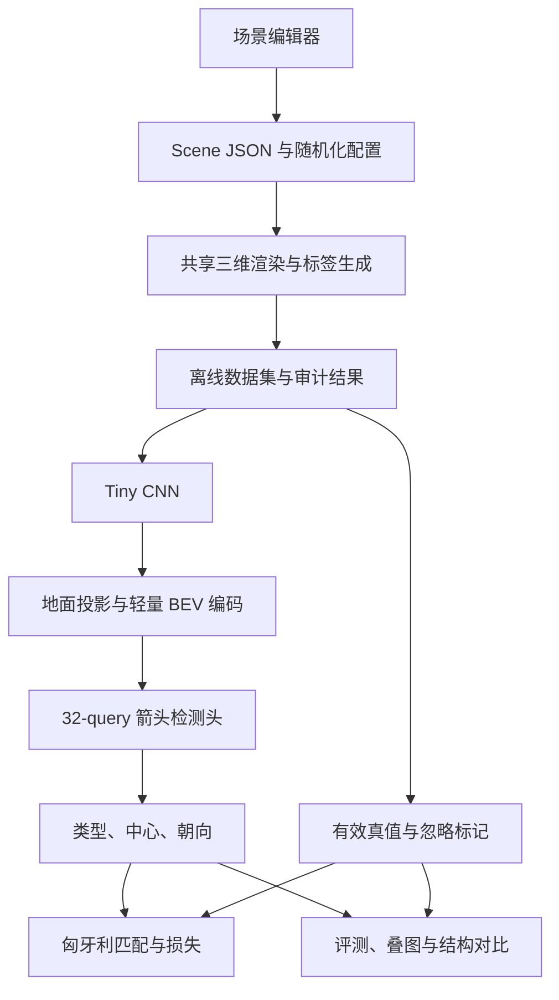

# 车道箭头仿真与 BEV 检测 Toy：开发设计书

版本：v1.0  
日期：2026-10-24  
仓库：ChenLiangzai97/toy_roadmark_detection  
实施对象：本地 GLM5.3 Agent  
本次交付：开发设计；本文中的耗时和精度是待实测的工程目标，不是已完成的实验结果。

## 0. 给实施 Agent 的指令

先完整阅读本文，再检查仓库中的 AGENTS.md、已有代码和运行环境。当前设计形成时仓库为空。用户授权本次上传设计文档，后续实现由本地 Agent 执行。

按第 16 节的阶段顺序实施，每个阶段通过自己的验收后再进入下一阶段。不要一次性写完整个工程后才检查投影、标签和训练链路。常规实现选择可以自行完成，并记录实际选择；涉及修改已确认需求时，应先说明影响。

必须交付可运行的编辑器、可复现的数据生成、训练、评测及结构对比工具。不能以界面截图代替训练，也不能以 loss 下降代替检测效果。没有运行的 GPU 实验必须写为“未运行”，不得估算成实测结果。

遇到问题时优先检查坐标、图像与真值一致性、梯度和性能瓶颈。对同一问题最多进行 5 次有明确假设的修复尝试；仍无法解决时，整理日志、已排除项和下一步所需信息再反馈用户。

## 1. 目标、已确认需求和默认决策

### 1.1 要解决的问题

用完全由仿真生成的数据，快速验证地面箭头辅助检测网络能否学习，以及调整结构后的效果。数据生成器同时是一个可人工编辑的三维场景编辑器。

总体流程：

1. 从只有地面的场景开始，人工放置物体、绘制车道、放置箭头和设置相机。
2. 根据场景和相机生成 RGB、箭头几何真值、像素 mask 和可见性信息。
3. 从单帧相机图像提取特征，构造 BEV 特征。
4. 32 个 query 读取 BEV 特征，预测箭头类型、BEV 中心及几何朝向。
5. 在相同数据和预算下比较结构，并输出预测叠图、指标、耗时和显存。

### 1.2 用户已经确认的要求

| 项目 | 要求 |
|---|---|
| 数据来源 | 仿真数据；首版不使用真实驾驶数据 |
| 编辑器初始状态 | 只有地面，训练相机作为配置存在 |
| 编辑能力 | 添加、移动、旋转、缩放简单物体；画车道；放箭头；配置多个相机；预览、保存、导入和批量生成 |
| 时间输入 | 单帧，不实现时序记忆 |
| 箭头头输入 | **BEV 特征** |
| 检测头 | 沿用既有任务书：**32 个可学习 query + Transformer decoder + 分类/中心/朝向三个分支** |
| 监督 | 被物体或其他实体遮挡的箭头不监督 |
| 硬件 | 按单张 RTX 4080、16 GB 显存设计 |
| 快速迭代 | 希望每版训练控制在 **10 分钟**，允许减小模型 |
| 开发顺序 | 箭头检测 → 单独验证车道转向任务 → 两任务组合 |
| 当前实施范围 | 完成箭头检测闭环；数据侧为后续车道任务保存所需信息 |

### 1.3 本文为消除歧义而给出的默认决策

以下是可直接实施的默认值，不表示用户曾逐项指定。改变默认值需要在报告和配置中记录。

| 未明确项 | 默认决策 |
|---|---|
| 首版训练相机数 | 一个前视相机；数据格式保留相机维度，编辑器可配置多个相机 |
| 运行方式 | 本地浏览器编辑器 + 本地 Python/PyTorch 训练，不依赖云端服务 |
| 地面 | 平面，世界高度 z=0；物体有真实高度并参与遮挡 |
| BEV 编码 | 利用已知相机标定，将图像特征采样到地面 BEV 网格 |
| 预训练 | 默认随机初始化，无外部预训练权重和下载依赖 |
| 遮挡含义 | 部分遮挡和完全遮挡都忽略；只容忍经测试确认的栅格化边界误差 |
| 图像截断 | 与物体遮挡分开记录；首版截断、太小或缺少视觉证据的箭头也忽略 |
| 箭头 mask | 首版必须生成和检查；首版检测头不预测 mask、不加 mask loss |
| 类别 | 直行、左转、右转、直左、直右、左右，共 6 类；掉头后续扩展 |
| 指标用途 | 受控仿真中的可学习性、学习速度和泛化；真实系统收益另行验证 |

多相机训练和车道转向预测不作为箭头首版验收的前置条件。首版接口应使它们后续可以接入。

## 2. 总体架构与模块边界



三个模块之间通过文件和稳定接口连接：

- **场景与渲染模块**：只负责几何、RGB、mask、标定和真值。
- **模型与训练模块**：输入 RGB 和标定，构造 BEV、预测并训练。
- **评测模块**：读取预测和真值，独立计算指标；与训练损失的匹配实现分开。

编辑器预览与批量渲染必须复用同一套场景构建、箭头模板和相机转换代码。禁止编辑器画一种箭头、离线脚本重新画另一种箭头。

BEV 编码器的首版利用“箭头在已知平面上”这一条件。首版结构结论主要适用于 BEV 后的箭头检测头；后续替换为学习式 BEV 编码器时，需要重新验证完整链路。

## 3. 技术选型和环境

### 3.1 推荐技术栈

| 部分 | 选型 | 原因 |
|---|---|---|
| 编辑器 | TypeScript + React + Vite + Three.js | 适合本地三维交互；预览和离线渲染可共享 |
| 交互 | OrbitControls、TransformControls、地面射线拾取 | 使用成熟的视角、变换和选点能力 |
| 批量渲染 | Node.js + Playwright Chromium，加载共享 render 页面 | 复用浏览器渲染代码，生成 RGB 和实例 ID |
| 本地服务 | FastAPI + Uvicorn | 提供生成任务、状态查询和静态页面 |
| 训练 | Python + PyTorch | 小模型、混合精度、配置化对比 |
| 匹配 | scipy.optimize.linear_sum_assignment | 小型代价矩阵即可 |
| 数据 | PNG、JSON/JSONL、NPY 或 NPZ | 易检查，避免首版引入复杂数据库 |
| 验证 | pytest + 前端测试框架 + Playwright | 重点覆盖投影、遮挡、匹配、梯度和操作流程 |

建议 Python 3.10 或 3.11，Node.js 22.12 或更新的兼容版本。优先复用用户已有的可运行 CUDA/PyTorch 环境，不擅自升级整套环境。模型只依赖 PyTorch 常规算子，无需 torchvision、MMCV、Detectron2、CARLA、Unreal 或自定义 CUDA 扩展。

实施时选定兼容依赖并锁定：提交 package-lock.json 和 Python 精确版本清单；记录 Python、Node、PyTorch、CUDA wheel、驱动、浏览器及 Three.js 版本。不要把动态 latest 当作可复现环境。

### 3.2 本地运行结构

生产式本地启动：Python 服务在 127.0.0.1:8765 提供已构建的编辑器、render 页面及 /api。

开发时允许 Vite 单独运行，并将 /api 代理到同一本地服务。批量渲染的 render_url 必须明确，不能依赖用户恰好打开的页面或当前选中的编辑视角。

渲染与 GPU 训练串行运行。生成完数据、退出批量渲染浏览器后再开始正式计时训练。

## 4. 坐标、相机与 BEV 契约

**先实现和验收本节，再写模型。** 所有长度单位为米；JSON 和模型内部角度为弧度；界面可以显示角度，但保存时转换为弧度。

### 4.1 坐标系

| 坐标系 | 轴方向 |
|---|---|
| 世界/自车 E | x 向前，y 向左，z 向上，右手系 |
| OpenCV 相机 C | X 向图像右，Y 向图像下，Z 沿光轴向前 |
| Three.js 相机 G | x 向右，y 向上，相机朝局部 -z 看 |

首版世界与自车坐标重合，保存 T_E_W 为单位矩阵，禁止只在代码中默认而不写元数据。

标定矩阵命名采用 T_目标_来源。T_C_E 把自车坐标转换为 OpenCV 相机坐标；T_E_C 是其逆矩阵。JSON 中矩阵使用按行排列的二维数组，禁止混用 Three.js 的底层列主序数组。

Three.js 世界也采用 z 向上。初始化 Object3D.DEFAULT_UP、编辑视角、训练相机与控件时保持一致。设置 up 并不会自动修正已建立的相机旋转，仍要以标定矩阵为准。

### 4.2 相机投影

使用针孔模型，首版不含畸变：

$$
\begin{bmatrix}X_C\\Y_C\\Z_C\\1\end{bmatrix}
=
T_{C\_E}
\begin{bmatrix}x\\y\\z\\1\end{bmatrix},
\qquad
u=f_x X_C/Z_C+c_x,\quad
v=f_y Y_C/Z_C+c_y.
$$

符号：x、y、z 是自车系点坐标；X_C、Y_C、Z_C 是相机系点坐标；T_C_E 是 4×4 外参；u、v 是图像连续坐标；f_x、f_y 是以像素为单位的焦距；c_x、c_y 是主点。仅在 Z_C>0 且落入成像范围时有效。

像素坐标采用**像素边缘为整数，像素中心为半整数**：第 j 列中心为 j+0.5，第 i 行中心为 i+0.5。宽 W、高 H 的中心主点为 [W/2,H/2]。不得将这一约定与像素中心为整数的另一套标定混用。

Three.js 与 OpenCV 相机坐标之间：

$$
T_{G\_E}=S T_{C\_E},\qquad S=\mathrm{diag}(1,-1,-1,1).
$$

T_G_E 是世界到 Three.js 相机的变换，S 将相机的 y、z 轴翻转；diag 表示对角矩阵。将它设置为 camera.matrixWorldInverse，其逆矩阵为 camera.matrixWorld，并正确更新相关矩阵，防止后续 lookAt 覆盖。

当 K 无 skew 时，可直接使用下面的 OpenGL 投影矩阵 P：

$
P=
\begin{bmatrix}
2f_x/W&0&1-2c_x/W&0\\
0&2f_y/H&2c_y/H-1&0\\
0&0&-(f+n)/(f-n)&-2fn/(f-n)\\
0&0&-1&0
\end{bmatrix}.
$

P 将 Three.js 相机坐标映射到裁剪坐标；n、f 分别是 near、far 裁剪距离；其余符号同上。先做齐次除法，再用 u=(x_ndc+1)W/2、v=(1-y_ndc)H/2 恢复图像坐标；x_ndc、y_ndc 是归一化设备坐标。

默认相机可用以下构造交叉检查：下俯角 alpha=12 度，相机位置 t=[0,0,1.7]；R_C_E 的三行依次为 [0,-1,0]、[-sin(alpha),0,-cos(alpha)]、[cos(alpha),0,-sin(alpha)]；T_C_E 的旋转块为 R_C_E，平移列为 -R_C_E t。alpha 保存前转为弧度，t 是相机在自车系中的位置，R_C_E 是自车到相机的旋转矩阵。

也可以先用 Three.js PerspectiveCamera 生成姿态与投影，再导出 OpenCV 标定，但必须满足上述等价关系。使用 Matrix4.set 等接口时确认传参行列语义，禁止直接把 JSON 二维数组 flatten 后当成 Three.js 内部 elements。

固定测试：同一组至少 20 个世界点，经 Three.js 投影和 Python 针孔投影，像素误差最大不超过 0.5 像素，且左右、远近和朝向一致。图像翻转必须只处理一次。

### 4.3 默认相机和范围

| 参数 | 默认值 |
|---|---|
| RGB 宽、高 | 320×192 |
| 相机位置 | 自车系 [0,0,1.7] 米 |
| 朝向 | 看向 +x，下俯 12 度 |
| 垂直视场角 | 60 度 |
| 主点 | [160,96] |
| 焦距 | 由垂直视场角和图像高计算，导出完整 K |
| near / far | 0.1 / 100 米 |
| BEV 范围 | x∈[2,18]，y∈[-4,4] 米 |
| BEV 特征尺寸 | H_bev=64，W_bev=32 |
| 真值 BEV mask 尺寸，H×W | 320×160，对应 0.05 米/像素 |

“下俯 12 度”应通过显式相机姿态或目标点实现，不能靠猜测 Three.js Euler 角顺序。相机可见范围与矩形 BEV 范围不同，网格必须带有成像范围有效 mask。

### 4.4 BEV 行列与回归坐标

BEV 图像和特征统一为：**前方在上，左侧在左**。行 r=0 对应最远处，列 c=0 对应最左侧。

$$
x=x_{\max}-(r+0.5)\Delta_x,\qquad
y=y_{\max}-(c+0.5)\Delta_y.
$$

x_max、y_max 是范围上界；r、c 是从零开始的行列索引；Delta_x、Delta_y 分别为前向和横向网格间隔。特征图为 0.25 米/格；高分辨率真值 mask 为 0.05 米/格。

模型回归的归一化中心为：

$$
x_n=(x-x_{\min})/(x_{\max}-x_{\min}),\quad
y_n=(y-y_{\min})/(y_{\max}-y_{\min}).
$$

x_n、y_n 是 [0,1] 内的归一化坐标；x、y 是米制中心；min、max 是各轴边界。模型输出顺序始终为 [x_n,y_n]，不是 [行,列]。预测可视化和指标计算前恢复米制坐标。

### 4.5 朝向语义

- 箭头类别表示相对于箭头入口方向的通行语义，如“左转”。
- 几何 yaw 表示模板中**从箭尾指向前进/分叉起点的轴线**在自车系中的方向。
- yaw=0 表示模板入口轴沿 +x，yaw 正方向是从 +x 朝 +y 旋转。
- 一个右转箭头在 yaw=0 时，类别仍为 RIGHT，不能把类别“右转”解释为 yaw=-90 度。
- 中心定义为规范化模板的固定锚点经旋转和平移后的坐标；模板初始化时将局部包围盒中心移到原点，之后不随投影、遮挡或朝向重新计算中心。
- 朝向分支输出 [cos(yaw),sin(yaw)]。此处 yaw 是几何角；cos、sin 分别为余弦和正弦。

## 5. 场景编辑器

### 5.1 界面布局

左侧工具栏；中间三维编辑视图；右侧选中对象属性；底部或右下为训练相机预览。另有可切换的俯视预览与标签图层。

编辑视角只用于操作，不能自动变成训练相机。训练相机列表独立管理，当前预览相机与最终导出的 camera_id 对应。

### 5.2 必需操作

| 对象/动作 | 首版能力 |
|---|---|
| 地面 | 修改尺寸、颜色和简易纹理；默认平面 |
| 普通物体 | 方盒、圆柱、简单车辆盒模型；添加/删除/复制/移动/旋转/缩放 |
| 车道线 | 在地面依次选点建立折线；编辑点；设置实/虚线、颜色、宽度 |
| 车道 | 中心线、宽度、lane_id、允许转向集合；可显示左右边界 |
| 地面箭头 | 选择 6 类模板；放置、移动、旋转、统一缩放；设置 lane_id |
| 相机 | 添加/复制/删除，设置位置、朝向、分辨率和内参，预览视锥 |
| 场景 | 新建、保存 JSON、导入 JSON、撤销/重做 |
| 当前样本 | 导出 RGB、标签、可见 mask、无遮挡 mask 和 BEV 标签预览 |
| 批量生成 | 选择场景或生成模板、数量、种子、扰动范围和输出数据集名称 |

车辆模型可用多个盒体构造，不要求导入复杂资产。车道绘制首版采用可编辑折线，不要求自由手绘曲线或道路拓扑求解。

箭头模板的宽长比保持统一缩放；普通物体允许分轴缩放。界面明显区分类别和几何朝向，不能以“改 yaw”实现“左箭头变右箭头”。

### 5.3 场景保存

Scene JSON 为唯一场景事实来源，至少包含：

- schema_version、scene_id、scene_group_id、seed。
- 坐标系、单位、BEV 范围、T_E_W。
- 地面参数、物体及其稳定 ID/形状/姿态/材质。
- 车道中心线、宽度、ID、允许方向及已知性。
- 箭头 instance_id、template_id、类别、中心、yaw、scale、lane_id。
- 相机列表、K、T_C_E、图像尺寸、近远裁剪面。
- 渲染、光照与随机化配置及箭头模板版本。

使用版本化 JSON Schema 做运行时校验；前端和 Python 共用 schema 文件，避免分别猜字段。导入未知版本时应提示，不静默转换。同一个 instance_id 在单个场景内只能对应一个物理箭头。

### 5.4 共享渲染 API

render 页面提供自动化调用接口，示意：

```typescript
interface RenderRequest {
  scene: SceneV1;
  cameraIds: string[];
  passes: ("rgb" | "visible_instance" | "amodal_instance" | "bev_instance")[];
}

interface RenderResult {
  cameras: Record<string, {
    rgbPng: string;                    // base64，无 data: 前缀
    visibleInstancePng: string;        // 24-bit ID RGB PNG
    amodalPerArrowPng: Record<string, string>;
    calibration: CameraCalibration;
  }>;
  bevInstancePng: string;
  labels: SampleLabelsV1;
}

window.toyRenderer.renderSample(request: RenderRequest): Promise<RenderResult>;
```

大批量作业逐样本传输、写盘和释放资源，不能在浏览器内积攒整个数据集。amodal 指移除其他遮挡物后该箭头在当前相机中的完整投影，不是让模型补全不可见内容。

## 6. 箭头模板、RGB、mask 与遮挡

### 6.1 类别表

| class_id | 名称 | 允许方向 [S,L,R] |
|---|---|---|
| 0 | STRAIGHT | [1,0,0] |
| 1 | LEFT | [0,1,0] |
| 2 | RIGHT | [0,0,1] |
| 3 | STRAIGHT_LEFT | [1,1,0] |
| 4 | STRAIGHT_RIGHT | [1,0,1] |
| 5 | LEFT_RIGHT | [0,1,1] |

S、L、R 分别表示直行、左转、右转。无目标只用于模型分类，编号 6，不是场景实体类别。模板 ID 与类别 ID 分开，以支持同类的多个外形版本。

### 6.2 模板实现

使用地面平面上的闭合多边形，保存在可检查的模板文件。每个模板明确：

- 顶点和轮廓；入口轴；固定锚点；规范长宽；类别。
- 组合箭头必须是一件物理实例，共用 instance_id。
- 由“入口直杆、转弯连接段、三角箭头”组成基础形状，再做多边形并集和三角化。不能把左/右类别编码成普通直箭头的旋转。
- 直行模板可从以下局部顶点起步，局部 a 向前、b 向左，单位为米：

```json
[[-1.5,-0.12],[0.5,-0.12],[0.5,-0.48],[1.5,0],
 [0.5,0.48],[0.5,0.12],[-1.5,0.12]]
```

左/右模板应有可辨识的入口杆和转弯支路；右模板由左模板沿局部 b 轴镜像生成。直左、直右和左右模板由共享入口杆与相应支路并集形成。每类模板先输出正视俯视图，检查类型、入口方向和外形，再进入数据生成。

首版不要求复刻道路标线国家标准；要求轮廓能表达上述语义、可旋转缩放，并且 RGB、所有 mask、几何标签使用完全相同的轮廓。

### 6.3 RGB 渲染

箭头贴在 z=0 平面上，通过 polygonOffset 等一致方式避免与地面深度冲突。不要为解决闪烁把箭头抬高到会改变投影几何的高度。

RGB 使用普通可见材质，所有类别默认白色；光照、地面颜色和物体材质与类别独立随机。实例 ID、类别 ID 和坐标信息不能以调试文字、特殊颜色或图层混入 RGB。

### 6.4 实例 ID pass

- 每个箭头 instance_id 编码为精确 RGB 整数：id=R+256G+65536B；R、G、B 是 0～255 的整数通道，0 为背景，箭头从 1 开始。
- visible pass 渲染所有遮挡物；遮挡物输出背景 ID，但必须正常写深度。
- 单箭头 amodal pass 仅渲染该箭头，移除其他实体遮挡，保留相同相机和画布。
- ID pass 关闭抗锯齿、多重采样、色调映射、抖动、混合、雾和 RGB 光照效果，使用原始整数颜色。渲染目标和读回路径避免 sRGB 转换。
- 读取像素后统一转换为左上原点；保存时禁止再次翻转。
- 遍历解码后的唯一 ID，必须是当前已分配 ID 与 0 的子集；出现额外值即失败。
- GPU 窗口预览可以抗锯齿，但监督 mask 必须使用上述确定的 ID pass。

不要只将普通 RGB 换成鲜艳颜色后截图，再用“近似颜色”猜实例。这会在轮廓和遮挡边界产生错误标签。

### 6.5 遮挡与其他忽略规则

每个箭头、每个相机保存：amodal_px、visible_px、occluded_px、truncated、in_front、in_image、bbox_px、visible_ratio、ignore_reason。无遮挡 mask 的含义是完整投影轮廓，可见 mask 的含义是经过深度遮挡后仍可见的部分。

$$
\rho=A_{\mathrm{vis}}/\max(1,A_{\mathrm{amodal}}).
$$

rho 是可见比例；A_vis 是可见像素数；A_amodal 是无遮挡投影像素数。仅在 A_amodal>0 时使用该比例。不要用 0/0 推导可见性。

默认实例可监督条件同时满足：

1. 中心与完整轮廓位于指定 BEV 区域。
2. 当前训练相机有完整且足够大的投影：amodal 面积≥64 像素，包围盒短边≥4 像素。
3. 轮廓不被图像边界截断，并处于相机前方。
4. 没有被其他实体遮挡，模板和几何字段有效。

遮挡量优先由同栅格、同相机的 ID pass 精确计数。默认任何确认的遮挡都忽略；如存在渲染边界噪声，只能通过无物体/有物体对照测试标定容差。允许的容差上限为 max(1 像素, amodal 面积的 0.1%)，它不能作为允许轻度遮挡的业务阈值。

太小、截断、遮挡和相机外是不同原因，分别统计。完整真值不能删除，使用 arrow_valid=false 和 ignore_reason 表示忽略。

### 6.6 关键：忽略目标不能被当成背景

仅从正例列表删掉遮挡箭头还不够：如果同时把所有未匹配 query 监督成“无目标”，仍然在对被遮挡箭头施加负监督。

首版采用简单、保守的样本级规则：

- 用可监督箭头做正匹配和位置/朝向监督。
- 当前 BEV 区域中存在任何因遮挡、太小、截断、无视觉证据而忽略的箭头时，设置 allow_no_object=false。
- 这类样本的未匹配 query 分类目标设为 ignore_index，不接受背景损失。
- 没有有效箭头且有被忽略箭头时，整个箭头损失为与图兼容的零。
- 真正没有箭头、且标签完整的空场景，allow_no_object=true，正常训练背景分类。
- 正常完整可见场景，匹配 query 接受前景分类，其余 query 接受背景分类。

这会牺牲部分背景监督，首版用足够多的干净场景弥补。局部 ignore 等更精细策略作为后续独立修改，不在首版默默引入。

## 7. 数据集契约与生成

### 7.1 文件组织

| 路径 | 内容 |
|---|---|
| data/arrow_v1/manifest.json | 数据版本、配置、类别、范围、生成器版本、校验摘要 |
| data/arrow_v1/samples.jsonl | 样本索引，每行一个样本 |
| data/arrow_v1/splits/train.txt | 训练 sample_id 列表 |
| data/arrow_v1/splits/val.txt | 验证 sample_id 列表 |
| data/arrow_v1/splits/test.txt | test_clean 的 sample_id 列表 |
| data/arrow_v1/splits/test_occlusion.txt / test_pose.txt | 两组独立诊断集的 sample_id 列表 |
| data/arrow_v1/samples/000001/scene.json | 完整场景 |
| data/arrow_v1/samples/000001/rgb/front.png | 当前相机 RGB |
| data/arrow_v1/samples/000001/masks/front_visible.png | 可见实例 ID 图 |
| data/arrow_v1/samples/000001/masks/amodal/front/1.png | 指定箭头无遮挡二值 mask |
| data/arrow_v1/samples/000001/masks/bev_instance.png | 完整几何 BEV 实例 ID 图 |
| data/arrow_v1/samples/000001/labels.json | 几何、相机、可见性、车道和监督标记 |
| data/arrow_v1/cache/ | 训练缓存，不作为原始标签唯一来源 |
| data/arrow_v1/audit.json | 分布、忽略统计、投影和 mask 检查结果 |

RGB 与像素 mask 不能混用有损压缩。训练不在每个 step 读 mask 或执行三维渲染；mask 用于离线标签生成、审计和后续扩展。

### 7.2 标签最小示例

以下是字段语义示例，实际文件需补齐所有相机矩阵和可见性统计，不能把示例直接当成完整有效样本。

```json
{
  "schema_version": 1,
  "sample_id": "000001",
  "scene_group_id": "layout_000123",
  "coordinate_frame": "ego_x_forward_y_left_z_up",
  "units": {"length": "m", "angle": "rad"},
  "bev_range": {"x_min": 2.0, "x_max": 18.0, "y_min": -4.0, "y_max": 4.0},
  "training_camera_ids": ["front"],
  "allow_no_object": true,
  "arrows": [
    {
      "instance_id": 1,
      "class_id": 2,
      "template_id": "right_v1",
      "center_ego": [10.0, 1.2, 0.0],
      "yaw_rad": 0.0,
      "direction_xy": [1.0, 0.0],
      "scale": 1.0,
      "lane_id": "lane_1",
      "arrow_valid": true,
      "orientation_valid": true,
      "ignore_reason": null,
      "visibility": {
        "front": {
          "amodal_px": 210,
          "visible_px": 210,
          "visible_ratio": 1.0,
          "truncated": false,
          "occluded": false
        }
      }
    }
  ],
  "lanes": [
    {
      "lane_id": "lane_1",
      "centerline_ego": [[2.0,1.2,0.0],[18.0,1.2,0.0]],
      "width_m": 3.4,
      "allowed_turns_slr": [0,0,1],
      "world_rule_known": true,
      "current_rule_valid": true,
      "rule_source": "CURRENT_ARROW"
    }
  ]
}
```

### 7.3 默认数据规模和分布

| 集合 | 首版数量 | 用途 |
|---|---:|---|
| overfit | 16～32 个独立简单场景 | 检查学习链路 |
| train | 6,000 样本 | 10 分钟快模式 |
| val | 600 样本 | 阈值、结构诊断、选 checkpoint |
| test_clean | 600 样本 | 固定干净测试 |
| test_occlusion | 200 样本 | 验证忽略与遮挡逻辑，单独报告 |
| test_pose | 200 样本 | 相机扰动与朝向泛化，单独报告 |

默认干净样本每帧 0～4 个箭头：空帧 15%，1/2/3/4 个分别占 35%/30%/15%/5%。类别对**实例数**尽量均衡。初版最多 4 个是快模式数据难度选择，检测头容量仍为 32；另生成 8～12 个箭头的压力样例检查重复和容量。

干净集保持无目标遮挡；可以有不遮挡箭头的物体。遮挡集包括部分遮挡、完全遮挡、一个可见加一个遮挡、全部遮挡四类情况。大规模生成前先人工检查每类不少于 8 个样例。

### 7.4 随机化与防止捷径

- 箭头位置、类别、尺度、几何朝向与实例编号解耦；类别不能固定出现在某条车道或某个 BEV 格子。
- 同类别可有轻微宽度和比例变化；默认尺度 0.85～1.15。
- 默认朝向覆盖 -pi～pi，并保证主要朝向分桶都有样本。pi 表示圆周率。
- 有 lane_id 的箭头，其入口方向应与绑定车道的行驶切线一致；可通过随机化道路方向覆盖不同 yaw。单独测试自由旋转的箭头可以不绑定车道，此时 lane_id=null，对应车道规则为未知。不能把随机反向箭头强行赋给固定朝向车道，再生成错误的车道转向标签。
- 保持箭头不相互覆盖；生成难以分辨或被边界截断的样本时标为 ignore，不能强制当正例。
- 地面颜色、车道线、普通物体、光照随机化与类别独立。
- 单独保留固定场景位置、只替换箭头类别的对照样本。
- 原始 clean 集固定相机；test_pose 改变高度、俯仰、偏航，并同步更新标定。训练中是否加入相机扰动由独立配置控制。
- 按位置、朝向、类别、可见面积分桶审计。拒绝采样可能引入类别位置偏差，需统计实际接受分布。
- 不使用导航、未来轨迹、真实类别、mask、lane_id 或世界规则作为模型输入。

### 7.5 划分与复现

先产生 scene_group_id，再按 group 固定划分 train/val/test。同一布局衍生的不同光照、相机位置和箭头替换样本必须进入同一 split，不能按导出的图片随机划分。

保存 master_seed、布局/样式/相机/箭头随机种子及 PRNG 实现版本。使用确定的 PRNG，不能依赖未设种子的 Math.random。

相同配置与种子应恢复同一几何和标签。同机同渲染环境验证输出一致性；跨浏览器/GPU 的 RGB 不保证逐字节一致，需锁定版本并记录差异。

生成完成后写 manifest 完成标记。训练拒绝使用尚未完成或审计失败的数据集。

## 8. 模型：Tiny CNN → BEV → Sparse Arrow Head

### 8.1 输入与输出

```python
# 输入
images: FloatTensor[B, N_cam, 3, H_img, W_img]   # [0,1] 后用固定统计量归一化
K: FloatTensor[B, N_cam, 3, 3]
T_C_E: FloatTensor[B, N_cam, 4, 4]
camera_valid: BoolTensor[B, N_cam]

# 输出
pred_logits: FloatTensor[B, 32, 7]       # 6 类 + 无目标
pred_center_norm: FloatTensor[B, 32, 2]  # 顺序 [x_n,y_n]
pred_direction_raw: FloatTensor[B, 32, 2]
```

B 为批大小；N_cam 为相机数量，首版为 1；H_img/W_img 为图像高/宽。不得用 scene_id、sample_id 等隐式检索标签。

### 8.2 Tiny backbone

默认从零训练，输入 [B,3,192,320]：

| 层 | 操作 | 输出形状，不含 B |
|---|---|---|
| stage1 | Conv3×3:3→16，stride1/padding1；GroupNorm；SiLU；AvgPool2×2 | [16,96,160] |
| stage2 | Conv3×3:16→32，stride1/padding1；GroupNorm；SiLU；AvgPool2×2 | [32,48,80] |
| stage3 | Conv3×3:32→64；GN；SiLU；Conv3×3:64→64；GN；SiLU | [64,48,80] |

GroupNorm 组数使用能整除通道数的 4 或 8，并写入实际配置。stage3 的卷积 stride1/padding1。

选择非重叠 AvgPool 下采样是为了明确特征像素中心：stride4 特征的第 j 列对应原图连续坐标 4(j+0.5)。不要换成另一种下采样后继续沿用同一投影网格而不检查中心偏移。

默认 RGB 归一化为 (image-0.5)/0.5；image 为 [0,1] RGB，两个 0.5 分别是固定均值和标准差。首版不从测试集估计统计量。

### 8.3 地面特征投影

1. 按第 4 节生成 BEV 每个格子的中心 [x,y,0]。
2. 使用 K、T_C_E 投影到原图连续坐标 [u,v]。
3. 原图宽高为 W、H 时，生成 grid_sample 的坐标：
   
$$
g_x=2u/W-1,\qquad g_y=2v/H-1.
$$

g_x、g_y 是归一化采样坐标；u、v 是原图连续坐标；W、H 是原图宽高。此式依赖前述像素中心和 backbone 下采样契约。

4. 调用 grid_sample，mode=bilinear、padding_mode=zeros、align_corners=false，采样图像特征，而不是采样 GT mask 或预先画好的 BEV 标签。
5. valid 为相机前方且落入图像的 BEV 格子；它仅表示标定决定的成像范围，**不包含由真值遮挡计算出的可见性**。
6. 首版只有一个相机。后续多相机时按几何有效相机数量做均值融合，并同步输出 coverage mask，不重复计数物理箭头。
7. 相机姿态固定时可缓存投影网格；缓存 key 包含 K、外参、原图和特征尺寸、BEV 范围、采样约定。姿态变化时必须重新计算或命中对应 key。

投影矩阵、除法和采样网格使用 FP32。为兼容选定 PyTorch/CUDA 组合，首版 grid_sample 明确在 autocast 关闭的区域使用 FP32 特征与网格；其前后转换仍保留 backbone 梯度。输出可转回训练计算 dtype。

缺少有效 BEV 格子时要报清楚相机/范围配置错误，不能让全被 mask 的 attention 产生 NaN。

### 8.4 BEV neck 与 token

投影后 [B,64,64,32] → 深度可分离卷积块：

- Depthwise Conv3×3，groups=64，padding1。
- GroupNorm + SiLU。
- Pointwise Conv1×1，64→64。
- GroupNorm + SiLU。

再按行优先展平为 [B,2048,64]，附加由米制 BEV 格子位置生成的二维正弦位置编码。位置编码在 decoder 中加入 key，不把类别、mask 或箭头位置作为位置编码来源。

此处 2048=64×32；64 是隐藏通道数。BEV token 有效 mask 从几何 coverage 继承。首版不加全局 BEV self-attention，以控制计算量。

### 8.5 32-query decoder

默认隐藏维度 D=64，2 层，4 个 attention head，FFN 宽度 128，dropout=0；D 表示 query 和 memory 的通道数。使用 Pre-LN 残差结构。

- 32 个独立可学习 query position embeddings，形状 [32,D]，初始化为均值 0、标准差 0.02 的高斯。
- 初始 query content h=0，形状 [B,32,D]。
- BEV memory 先做 LayerNorm，位置编码记为 p，query embedding 记为 q。
- 每层按以下顺序：

```python
a = ln_self(h)
h = h + self_attn(query=a+q, key=a+q, value=a)

a = ln_cross(h)
h = h + cross_attn(query=a+q, key=memory+p, value=memory,
                   key_padding_mask=~memory_valid)

h = h + ffn(ln_ffn(h))   # Linear(D,2D) -> GELU -> Linear(2D,D)
```

h 是 query content；q 是可学习 query 位置向量；memory 是标准化后的 BEV 特征；p 是 BEV 位置编码；ln 表示对应 LayerNorm；~ 表示布尔取反，使无效 memory 被 attention 屏蔽。

标准结构包含 query self-attention，同时暴露 use_self_attention 开关用于单变量消融。第一层读取场景前的 self-attention 不具有当前场景内容，不能将其解释为已经完成实例去重。

首版只监督最后一层。不默认添加去噪 query、辅助层 loss、参考点、框预测、NMS 或额外拓扑模块。

### 8.6 三个分支

对最终 LayerNorm 后的 query 特征分别预测：

| 分支 | 结构 |
|---|---|
| 类别 | Linear(D,7)，输出 logits |
| 中心 | Linear(D,D) → GELU → Linear(D,2) → sigmoid |
| 朝向 | Linear(D,D) → GELU → Linear(D,2)，输出原始向量 |

朝向在计算余弦误差时用安全归一化；向量范数小于 1e-6 时记录无效朝向，不将零向量假装成确定方向。

首版参数目标小于 0.5M；以上结构预计约 0.2M，必须用实际代码统计 trainable/total 参数量。参数数目不能替代耗时和显存测量。

### 8.7 可替换接口

至少拆分出：

```python
backbone(images) -> image_features
bev_encoder(image_features, K, T_C_E, camera_valid) -> bev_features, bev_valid
arrow_head(bev_features, bev_valid, bev_geometry) -> predictions
criterion(predictions, targets) -> loss_dict
evaluator(predictions, targets, eval_config) -> metrics
```

criterion 不负责生成真值，evaluator 不依赖训练时的匹配结果。后续更换 BEV encoder 或检测头时，保持统一输出契约。

## 9. 匹配、损失与忽略

### 9.1 匈牙利匹配

只在 arrow_valid=true 的真值上匹配，代价：

$$
C_{ij}=-\log(p_i(c_j)+\epsilon)
       +5\lVert\hat{\mathbf r}_i-\mathbf r_j\rVert_1.
$$

i 是 query 索引，j 是真值索引；C_ij 是匹配代价；p_i(c_j) 是 query 对真值类别 c_j 的 softmax 概率；带帽 r_i 是预测归一化中心，r_j 是真值归一化中心；L1 范数是两个坐标的绝对误差之和；epsilon=1e-8 是数值下限。权重 1 和 5 是首版默认值，需配置化。

匹配在无梯度环境计算，并将小型矩阵送 CPU 调用 SciPy。匹配离散索引用于选取可微损失，匹配代价自身不额外加到总 loss。

真值数量超过 32 时显式报错，禁止截断或私自增加 query。训练代码不能将真值顺序与 query 编号固定绑定。

### 9.2 三项损失

$$
L=L_{\mathrm{cls}}+5L_{\mathrm{pos}}+L_{\mathrm{ori}}.
$$

L 为总箭头损失；L_cls 是分类交叉熵；L_pos 是匹配中心的归一化 L1；L_ori 是有效朝向的余弦误差。1、5、1 为各项权重。

- 分类：匹配 query 为前景；符合 allow_no_object 的未匹配 query 为无目标；其他 query 为 ignore_index。
- CE 类别权重为 [1,1,1,1,1,1,0.1]。使用 PyTorch 加权均值语义，分母是参与样本的类别权重之和；无有效 query 时返回图兼容零。
- 位置：匹配实例的两坐标绝对误差求和，再除以有效匹配实例数。
- 朝向：

$$
L_{\mathrm{ori}}=
\frac{1}{\max(1,N_o)}
\sum_{j=1}^{N_o}\left(1-\hat{\mathbf d}_j^\mathsf T\mathbf d_j\right).
$$

N_o 是匹配且朝向有效的实例数；带帽 d_j 是安全归一化的预测方向；d_j 是真值单位方向；上标 T 为转置，乘积为点积。没有有效朝向时返回图兼容零。

每项损失记录自己的有效计数。首版单卡，不实现未经验证的多卡归约。类别、位置、朝向分开输出，不能仅记录加权总和。

### 9.3 数值和梯度要求

- softmax/log、匹配、损失归约、朝向归一化使用 FP32。
- 默认 BF16 autocast；不支持时使用 FP32 并记录速度。BF16 默认不使用 GradScaler。
- 梯度裁剪范数 1.0；发生非有限梯度时保存样本 ID、配置和分项诊断，停止并定位，不持续跳过来伪造成功训练。
- Backbone→投影采样→BEV neck→decoder 必须可反向传播，禁止意外 detach 或 numpy 转换切断特征链路。
- 忽略标签先安全处理再计算 loss；不能用 NaN×0 当作屏蔽。
- 若只有被忽略箭头，反向应无该任务梯度；真正空帧仍有背景梯度。

## 10. 10 分钟快速训练模式

### 10.1 计时边界

**验收预算：一个 train 进程从开始加载已准备的数据，到验证完成、checkpoint 和指标写完，墙钟时间≤600 秒。**

该预算包含：

- Python/模型初始化、数据加载和缓存读取。
- 全部训练 step、固定的中途验证。
- 最终验证、checkpoint 和 metrics 写盘。

不包含一次性的环境安装、浏览器安装、离线渲染和 prepare-cache。上述准备时间必须另外报告，不能隐藏。若用户之后要求“从修改代码到结果”也≤10 分钟，再以已有数据和环境评测完整流程。

完整 test 和结构对比汇总由单独命令执行，耗时另记；每次训练结束至少完成规定的 val，不允许用只保存权重的 600 秒来冒充完整迭代。

### 10.2 默认配置

```yaml
seed: 42
dataset:
  root: data/arrow_v1
  train_split: train
  val_split: val
  input_size_hw: [192, 320]
  camera_ids: [front]
  cache_images: true
  cache_grid: true
model:
  backbone: tiny_cnn
  channels: [16, 32, 64, 64]
  hidden_dim: 64
  bev_size_hw: [64, 32]
  bev_range_xy: [2.0, 18.0, -4.0, 4.0]  # xmin,xmax,ymin,ymax
  bev_encoder: ground_plane
  num_queries: 32
  decoder_layers: 2
  attention_heads: 4
  ffn_dim: 128
  dropout: 0.0
  use_self_attention: true
train:
  device: cuda
  batch_size: 32
  max_steps: 1500
  optimizer: adamw
  lr: 0.001
  weight_decay: 0.0001
  warmup_steps: 75
  min_lr: 0.00003
  scheduler: cosine
  grad_clip_norm: 1.0
  amp_dtype: bfloat16
  num_workers: 4
  pin_memory: true
  persistent_workers: true
  log_every: 50
  eval_every: 500
  time_budget_s: 600
  reserve_finalization_s: 60
  compile: false
loss:
  class_weight: 1.0
  center_weight: 5.0
  orientation_weight: 1.0
  no_object_class_weight: 0.1
eval:
  center_thresholds_m: [0.5, 1.0]
  val_limit: 600
```

配置应支持命令行明确覆盖并保存最终 resolved_config.yaml。warmup 后用余弦衰减；warmup、总步数、最小学习率的实际序列写入日志，避免按 epoch 错误解释 max_steps。

### 10.3 数据缓存

6,000 张 320×192 RGB uint8 大约占 1.1 GB，另有标签和索引；不要默认将全部图像变成 FP32 常驻内存。prepare-cache 生成连续 uint8 数组或 mmap，可先用简单 NPY mmap；运行前核查主机可用内存。

训练只读取 RGB、标定和小型标签。mask、场景 JSON、可视化图不在每步解析。投影 grid 在相机固定时共享，不复制为每个样本一份大缓存。

### 10.4 性能测量和超时行为

先运行独立 benchmark：10 个预热 step + 30 个计时 step，测量真实前向、匹配、反向、优化器和数据加载，并同步 CUDA 计时。记录中位数/P90 step 时间、samples/s、显存 allocated/reserved 和 val 时间。

以默认 1500 step、最终处理预留 60 秒计算，训练 step 的平均预算约 0.36 秒；实际还要为初始化和中途验证留余量，因此不能只凭 GPU 计算时间判断通过。

训练进程：

1. 从入口记录单调时钟起点。
2. 使用实测 val/save 时间预留最终处理时间，默认至少 60 秒。
3. 固定 max_steps 是正常结束条件。
4. 若预算不足，停止训练并执行最终验证和保存，标记 status=budget_incomplete，记录 completed_steps。
5. 实测超过 600 秒标记 time_budget_pass=false，不能只把配置里的 time_budget_s 写成结果。
6. 被截断的 run 不能与完成固定步数的 run 直接作结构优劣结论。

如果默认配置超预算，按诊断结果调整。推荐顺序：数据加载/重复解码 → 关闭高频叠图和多余同步 → 减少验证频次但保留终验 → 选择 lite profile。不能只缩短训练步数并宣称同等质量。

lite profile：输入 [160,256]，通道 [16,24,48,48]，D=48，BEV=[48,24]，decoder 2 层、4 头、FFN=96、32 query。其他预算和数据保持可比。输入 resize 时同步按横纵缩放更新 K，不能沿用原 K。

切换 profile 会改变基线，必须让所有被比较版本使用同一 profile 重新跑。torch.compile 默认关闭，避免编译开销吞掉短实验；需要时作为独立性能实验。

### 10.5 学习效果和时间同时验收

10 分钟目标不等于能保证任意难度数据都充分收敛。快模式须同时报告精度、固定训练步数和真实耗时。

首版 clean held-out 集的工程目标：

| 指标 | 初始目标 |
|---|---:|
| mAP，中心距离 0.5 米 | ≥0.75 |
| 宏平均 F1，距离 0.5 米，阈值由 val 固定 | ≥0.85 |
| 正确类别匹配实例中心平均误差 | ≤0.35 米 |
| 正确类别匹配且朝向有效实例平均角误差 | ≤10 度 |
| 完整空帧平均误报数 | ≤0.10 个/帧 |
| 固定步数训练及最终 val/save | ≤600 秒 |
| 峰值 allocated 显存 | 目标≤12 GB |

这些是待验证的第一版目标，不是对结果的承诺。若时间达标而精度未达标，先检查第 15 节的问题；若需要调整难度、时长或验收阈值，必须报告原结果和原因，不能删掉困难样本后沿用旧数据版本。

## 11. 评测、可视化与报告

### 11.1 检测指标定义

不使用框 IoU 评测中心点任务。

- 每个 query 取 6 个前景类别的最大 softmax 概率及对应类别，保留全部候选用于 AP。
- AP 按类别、按置信度降序排列，在同帧中匹配最近且尚未匹配的**同类别有效 GT**，距离小于等于对应阈值为 TP，否则为 FP。
- 每个距离阈值独立评测；AP 用 101 个召回点的插值精度平均值；mAP 是有有效 GT 类别的 AP 算术平均，报告零 GT 类别。
- 不用训练 Hungarian 对应关系计算 AP。
- F1 的全局置信度阈值只在 val 的预设候选阈值上选择，固定后用于 test；不能在 test 挑最优阈值。
- 同一个 GT 被多个预测命中，只计最高优先级的一个 TP，其余为重复 FP。
- FN 是未命中的有效 GT；precision=TP/(TP+FP)，recall=TP/(TP+FN)，F1 为两者的调和平均。TP/FP/FN 分别为正确检测、误报、漏检数量；分母为零时显式记录约定。
- 中心误差和圆周最短角差在成功匹配子集上报告，同时报告召回，避免只看少量成功样本。
- 朝向角差用 atan2(sin(delta),cos(delta)) 的绝对值；delta 为预测角减真值角，atan2 返回考虑象限的角度，最后转换为度。
- 输出每类 AP、P/R/F1、混淆矩阵、重复率、空帧误报、有效/忽略数量。

### 11.2 含忽略箭头的评测

先完成有效 GT 的同类匹配，再处理剩余预测。对于同帧被忽略箭头，若未匹配预测中心位于其已知 BEV 几何轮廓向外扩张当前距离阈值后的区域，则移出该次 P/R/AP 计数，类别不作为必要条件；有效 GT 的匹配优先，不能被 ignore 区域抢走。

该 ignore 规则仅用于已知箭头的忽略区域，不能将全部画面都设为 ignore。记录被抑制预测数量。完全相机外、太小和遮挡目标分别统计。clean 指标与 occlusion 指标分开报告。

### 11.3 必需叠图

每个 run 至少保存固定的 24 个样例：

- 原相机 RGB、真值和预测中心重投影。
- BEV 真值/预测中心、类别、朝向、置信度、query 编号。
- 正确匹配连线、漏检、重复、忽略目标与其原因。
- coverage mask、场景车道和箭头归属。
- clean、组合类型、相邻箭头、空帧、部分/完全遮挡。

训练过程中每 step 不画图；中途只在固定少量样本生成，完整叠图在结束或独立评测时生成。

### 11.4 run 产物

| 文件 | 必需内容 |
|---|---|
| resolved_config.yaml | 最终生效配置 |
| environment.json | 硬件、软件、Git commit、参数量 |
| metrics.jsonl | step、分项 loss、LR、有效计数、吞吐、时间 |
| result.json | val 指标、完成步数、计时、显存、预算是否通过 |
| last.pt / best.pt | 模型、优化器、调度器、随机状态、step、配置和数据版本 |
| predictions_val.jsonl | query 原始预测与恢复米制坐标 |
| figures/ | 固定样例及曲线 |
| report.md | 结论、已完成验证、限制、失败样例和复现命令 |

best.pt 只根据固定 val 主指标选择；test 不能参与选 checkpoint。

## 12. 结构对比实验

先让基线通过投影检查、少样本拟合和一次快模式，再开结构实验。首版必须支持以下配置，实际默认只运行基线及 self-attention 关闭版本：

| 编号 | 改动 | 目的 |
|---|---|---|
| A | 基线：D64、2 层、32 query、self-attention 开 | 确立参考 |
| B | 只关闭 query self-attention | 评估 query 间交互和开销 |
| C | 只将 decoder 改为 1 层 | 比较层数和学习速度 |
| D | 只改隐藏维度为 48，FFN 保持 2D，BEV 和 backbone 采用兼容投影 | 比较头规模；记录连带参数调整 |
| E，后续可选 | 使用同一 BEV 特征的 dense heatmap 头 | 检查任务瓶颈和 sparse 头表现 |

query 始终 32，不把 query 数量作为首轮变量。D 为隐藏维度。D 的对比需要让 backbone 输出与头隐藏维度分离，通过 1×1 adapter 对接，明确 adapter 的参数和耗时。

必须固定数据及 split、随机种子、初始化规则、有效 batch、更新步数、优化器、输入、BEV 范围、评测与阈值流程。固定步数对比是主表；另可展示同一墙钟预算内的效果，不能混为一张表的同一结论。

只比较变更相关项。A/B 优先运行种子 42；出现差异后再用 43、44 重复，报告均值和波动；每个独立 run 都遵守快模式预算。

建议表格字段：版本、种子、参数量、完成步数、训练样本数、mAP@0.5、F1、中心/朝向误差、重复率、空帧误报、墙钟、显存、status。

如果 B 更快而精度下降，需要分别报告；不能只选对自己有利的指标。toy 的结构排序应连同数据难度和训练预算一起解释。

## 13. 为车道转向任务保留的数据

本阶段只实现数据字段和可视化，不把车道转向 loss 加入箭头基线。

保存每条车道的 ID、中心线、宽度/边界、规则适用车道段、allowed_turns_slr、world_rule_known；每个箭头保存 lane_id，绑定来自场景编辑状态，而非检测器事后猜测。

同时保存 current_rule_valid：当前可监督箭头能明确支持该段车道规则时为 true；只有被遮挡箭头或缺少视觉证据时为 false。仿真器知道世界规则不代表当前单帧模型拥有对应证据，不能直接强制监督不可见规则。

允许方向使用多热编码，未知通过 valid mask 表达，不把未知当 [0,0,0] 的全负规则。首版不启用历史标签或未来帧标签。

若同一规则车道段放置互相冲突的箭头，应提示/标记规则未知；不能用方向并集自动掩盖冲突。车道段跨规则变化边界时需要分段。

后续步骤：复用同一数据，单独开发和验证车道转向头，再与箭头任务组合；其具体网络及损失另行补充设计。

## 14. 建议仓库结构与命令契约

### 14.1 文件职责

| 路径 | 职责 |
|---|---|
| README.md | 安装、启动、数据生成、10 分钟训练和评测的最短路径 |
| docs/ARROW_TOY_DESIGN.md | 本设计书 |
| docs/IMPLEMENTATION_NOTES.md | 实际实现决策、接口差异、问题与证据 |
| schemas/scene_v1.schema.json | 场景 schema |
| schemas/sample_labels_v1.schema.json | 标签 schema |
| assets/arrows/*.json | 箭头多边形模板 |
| web/src/editor/ | 场景操作、属性面板、相机预览 |
| web/src/render/ | 共享构建、投影、RGB 和 ID pass |
| web/src/geometry/ | 坐标变换、模板和车道几何 |
| web/scripts/render_batch.ts | Playwright 批量渲染 worker |
| arrow_toy/editor_server.py | 本地页面、生成任务 API |
| arrow_toy/render.py | 数据生成入口和 Node worker 调用 |
| arrow_toy/data/ | Dataset、缓存、collate、审计 |
| arrow_toy/geometry/ | Python 投影和 BEV 变换 |
| arrow_toy/models/ | backbone、bev_encoder、decoder、heads |
| arrow_toy/losses/ | matcher、criterion |
| arrow_toy/evaluation/ | 独立检测评测、叠图、报告 |
| arrow_toy/train.py | 训练入口 |
| arrow_toy/benchmark.py | 真实性能测量 |
| configs/data_v1.yaml | 数据生成参数 |
| configs/quick.yaml | 10 分钟基线 |
| configs/quick_lite.yaml | 统一切换的轻量 profile |
| configs/overfit.yaml | 小样本拟合 |
| configs/ablations/no_query_sa.yaml | 只关闭 self-attention 的覆盖配置 |
| tests/ | 少量关键语义和集成测试 |
| examples/scenes/ | 固定验收场景 |
| data/、runs/ | 本地产物，默认不提交大文件 |
| pyproject.toml | Python 包和入口配置 |

不要为了凑目录创建空模块。按阶段添加真实实现。开发完成时补一个简短 AGENTS.md，指向本设计、必要命令、坐标规则和产物管理方式，不复制整份设计。

### 14.2 预期命令

以下是待实现的接口，不代表当前仓库已经具备这些命令：

```bash
# 构建并启动编辑器
npm --prefix web ci
npm --prefix web run build
python -m arrow_toy.editor_server --host 127.0.0.1 --port 8765

# 生成、审计和缓存数据
python -m arrow_toy.render --config configs/data_v1.yaml
python -m arrow_toy.data.audit --root data/arrow_v1
python -m arrow_toy.data.prepare_cache --root data/arrow_v1

# 几何和关键语义验证
python -m pytest tests/test_projection.py tests/test_visibility.py tests/test_matching.py

# 小样本拟合与性能测量
python -m arrow_toy.train --config configs/overfit.yaml --run-dir runs/overfit
python -m arrow_toy.benchmark --config configs/quick.yaml --output runs/benchmark.json

# 10 分钟基线与单变量对比
python -m arrow_toy.train --config configs/quick.yaml --run-dir runs/baseline_s42
python -m arrow_toy.train --config configs/quick.yaml --override configs/ablations/no_query_sa.yaml --run-dir runs/no_sa_s42

# 完整评测和结果对比
python -m arrow_toy.evaluation.evaluate --run-dir runs/baseline_s42 --split test
python -m arrow_toy.evaluation.compare --runs runs/baseline_s42 runs/no_sa_s42 --output runs/comparison
```

命令失败时返回非零退出码，打印可定位原因。训练结束的 result.json 要区分 success、budget_incomplete、failed_nonfinite、failed_data；成功进程退出不自动表示精度/预算验收通过。

### 14.3 最小本地生成任务 API

| API | 请求/返回 |
|---|---|
| GET /api/health | 服务版本、schema 版本、渲染 worker 可用性 |
| POST /api/render-jobs | 场景 JSON、生成参数、种子、数据集名称 → job_id |
| GET /api/render-jobs/{job_id} | 状态、已完成/总数、输出目录、错误 |
| POST /api/render-jobs/{job_id}/cancel | 请求停止，保留已完成样本但不标记完整 |
| POST /api/render-sample | 当前场景 → 一个样本及预览下载 |

任务状态为 queued/running/completed/failed/cancelled。Python 用参数数组启动 Node worker，生成进度以 JSONL 或受控状态文件通信。单个样本先写临时目录，完成后原子提交，避免中断留下看似完整的数据。

## 15. 关键检查与失败定位

### 15.1 必需测试

| 检查 | 验证内容 |
|---|---|
| 坐标往返 | T_C_E 与逆矩阵、单位和手性正确 |
| JS/Python 投影 | 固定点像素差≤0.5 px；左右不翻转 |
| BEV 行列 | 四角、前后左右、米制与归一化往返正确 |
| grid_sample | 用带明确梯度的坐标棋盘图检查采样点；align_corners 约定正确 |
| 模板 | LEFT/RIGHT 是镜像语义，组合箭头是单实例；yaw 与类别独立 |
| ID pass | 无非法 ID，PNG 读回不改值，图像不倒置 |
| 遮挡 | 遮挡前后 amodal 不变，visible 变化，目标按规则忽略 |
| 忽略负监督 | 有被忽略箭头时未匹配 query 的 CE 确实屏蔽 |
| 空帧 | 真空帧训练背景；全忽略帧箭头 loss 为零 |
| 匹配 | 重复候选只有一个正匹配；打乱 GT 顺序不改变非并列匹配后的损失 |
| 朝向 | 跨 -pi/pi 边界误差连续；近零方向向量不产生 NaN |
| 梯度 | 正样本下 backbone、BEV neck、decoder 和三个分支都有有限梯度 |
| 容量 | >32 有效实例显式失败 |
| 数据划分 | scene_group_id 不跨 split |
| checkpoint | 保存加载后相同输入预测一致 |
| 编辑器流程 | 空场景→放箭头/物体/车道→配置相机→保存重开→生成，结果一致 |

只编写能验证以上真实风险的检查，不为普通 getter、配置透传或每个 MLP 堆叠机械单测。

### 15.2 学不会时的诊断顺序

1. 对照 RGB、可见 mask、BEV 真值，检查坐标、左右和 yaw。
2. 只用一个无遮挡箭头、固定相机、16 个场景做过拟合，确认分类、位置和朝向都学。
3. 检查有效 GT 数量、背景权重、allow_no_object 比例、梯度和近零方向。
4. 检查同一 BEV 格子采样是否落在相机图的对应位置，特别是分辨率变换后的 K。
5. 检查远处箭头像素是否足够，不能要求网络识别已无法辨认的轮廓。
6. 必要时增加一个仅用于排障的 BEV 几何/类别通道 oracle 输入，检查检测头能否拟合。此输入含真值信息，只能作诊断，不能混入主实验或报告成 RGB 模型结果。
7. 再检查优化器、学习率、query 初始化、有效训练步数和数据难度。

一次只改变一类因素，保留失败 run 和对应配置。

## 16. 实施阶段、交付与验收

| 阶段 | 工作 | 进入下一阶段的条件 |
|---|---|---|
| P0 契约 | schema、坐标、模板、配置和环境记录 | JS/Python 投影与 BEV 转换通过 |
| P1 最小生成 | 固定相机、箭头、物体，RGB/ID/amodal/BEV pass | 固定无遮挡/遮挡样例正确 |
| P2 编辑器 | 场景操作、车道、相机预览、导入导出、生成任务 | 人工完成一条完整编辑流程，重开一致 |
| P3 数据 | 随机化、group 划分、审计和缓存 | 类别/位置/朝向分布合理，无 split 泄漏 |
| P4 模型 | Tiny CNN、BEV 投影、decoder、loss、评测 | 关键 mask/匹配/梯度检查及小样本拟合通过 |
| P5 快模式 | 4080 benchmark、固定 1500 step、val/save | 真实耗时、显存和精度同时报告 |
| P6 对比 | 基线与关闭 self-attention | 同配置预算的可复现实验与比较报告 |
| P7 交接 | README、实际设计差异、命令、失败限制 | 新终端按文档跑通 |

P4 小样本拟合的目标：16～32 个简单可见场景，在至多 1000 step 的诊断运行中，训练集 P/R 接近 1，中心误差≤0.2 米，朝向误差≤5 度；不通过时不得直接跑完整大集碰运气。这里是诊断目标，不是 held-out 精度。

P5 如果受限于环境无法运行 4080，必须交付可运行命令和已完成的 CPU/GPU 验证范围，将 10 分钟和精度标为待验收。不得仅凭模型小就标记预算通过。

最终交付应让用户能够：

1. 打开本地编辑器，从空地面建立场景并导出样本。
2. 用固定配置和种子批量生成、审计并缓存数据。
3. 用一个命令运行快模式训练，看到实际耗时和是否达标。
4. 在相机图和 BEV 中查看预测、真值和忽略原因。
5. 只改一个结构开关，生成一张公平对比表。
6. 在同一数据契约上继续实现车道转向任务。

## 17. 本版明确保留给后续的工作

多相机训练融合、时序记忆、真实数据迁移、非平面道路、复杂资产、物理车辆运动、学习式深度/BEV 编码、mask 预测、车道转向网络和规划闭环均在首版闭环之后安排。

编辑器可以配置多相机并导出标定；首版训练配置只消费 front。场景中物体有高度并参与真正的深度遮挡，因此数据生成器仍是三维编辑/渲染系统。

## 18. 参考材料与使用范围

1. [DETR：End-to-End Object Detection with Transformers](https://arxiv.org/abs/2005.12872)：采用 query 集合预测与一对一匹配的基本思路；本文的小模型、地面 BEV 和训练预算是本项目设计。
2. [PyTorch grid_sample](https://docs.pytorch.org/docs/stable/generated/torch.nn.functional.grid_sample.html)：实现采样坐标、插值和 align_corners 约定。
3. [PyTorch AMP](https://docs.pytorch.org/docs/stable/amp.html)：实现 autocast；最终以项目锁定的 PyTorch 版本验证行为。
4. [Three.js WebGLRenderer](https://threejs.org/docs/pages/WebGLRenderer.html)：场景渲染、render target 和像素读回。
5. [Three.js 文档](https://threejs.org/docs/)：相机、ShapeGeometry、控件和矩阵接口。
6. [NVIDIA RTX 4080 系列规格](https://www.nvidia.com/en-gb/geforce/graphics-cards/40-series/rtx-4080-family/)：16 GB 显存规格；不能据此推导本项目已经达到 10 分钟。
7. 需求依据：本次会话确认的单帧、BEV 输入、32 query、忽略遮挡和 10 分钟目标；既有《地面箭头 Sparse 辅助任务开发任务书》《车道中心线转向属性辅助任务开发任务书》的接口原则。

## 19. 实施完成后的报告模板

```markdown
# 实现与验证报告

- 实现 commit：
- 环境与 GPU：
- 数据版本/哈希及 split：
- 生效配置：
- 实际网络参数量：
- 与设计书的差异及理由：

## 已完成阶段
| 阶段 | 结果 | 证据/产物 |

## 快模式结果
| 版本/种子 | 完成步数 | mAP@0.5 | F1 | 中心误差 | 角误差 | 墙钟秒 | 显存 | status |

## 关键语义检查
投影、遮挡、背景忽略、匹配、梯度、数据划分、保存加载。

## 失败与限制
保留失败样例；区分未实现、未运行和已运行未通过。

## 复现命令
安装、编辑器、生成、审计、缓存、训练、评测、对比。

## 后续建议
先说明依据，再提出下一项单变量实验。
```
